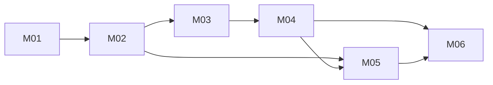

# Polyquack Build Plan

Baseline: RV-001
Change folders: docs/changes/; milestone folders are named YYYY-MM-DD-Mxx-<english-slug>

Milestone status (no status is stored in this plan):

```bash
grep -iH -m4 -E '^(Verdict|Acceptance|Verified by|Open limitations):' docs/changes/*-[Mm][0-9]*-*/verification.md
```

Changes since approval: `Polyquack/` is not a git repository yet, so they cannot be checked with `git log`. Once the repository exists, the approval commit can be found with `git log -1 --format=%H -S'status: approved' -- docs/spec/manifest.yaml`.

## Strategy

Vertical slices: each milestone leaves something observable end to end, from the platform to the database and a report. The clock rules. The E1 verdict needs 4 weeks on paper with our own data (PD-009), and order books have no history. That is why ingestion goes first and must be running 24/7 as early as possible, while the rest is built.

The highest-risk assumptions, in order:

1. That the live channels of both platforms allow building and resyncing the order book of each minute (ADR-004). It has never been tested in this project.
2. That the REST pace does not trigger blocks on Polymarket Perps, whose limit is not published (NFR-005).
3. That SQLite withstands Ingestion and the Evaluator writing at the same time without losing minutes (F-010).
4. That the evaluator does not see the future: the funding accrual rule and the hourly cutoff (BR-004, NFR-008).

Debt resolution: the open MINOR findings in the ledger (F-006, F-007, F-008, F-010, F-011, F-012, F-013, F-014, F-015) block nothing, but each one is resolved in the change folder of the milestone that touches its concept, declared in its Canonical Design Impact. Each milestone lists them.

## Architecture Proof Slice

Milestone: M01

Why it is the minimum useful end-to-end proof:

- It touches every piece of Ingestion with a single pair (BTC): discovery and pairing, funding over REST, batched prices, order books over the live channel with resync, SQLite database and gaps.
- It tests assumptions 1 and 2 first, which are the most expensive to discover late.
- It runs as a service on the VM (ADR-001). If something fails, it is known before the evaluator is built.

## Dependency Graph



M05 (dashboard) can start with the ingestion part as soon as M02 exists. The E1 part waits for M04.

## Milestone M01 — One pair (BTC) is ingested end to end on the VM

Goal:
On the VM, a service stores the hourly funding, the mark and index price of each minute and a book snapshot of each minute for the BTC pair on both platforms. Minutes or hours without data are recorded as gaps. A command shows the pair's latest readings and gaps.

Requirements:
- FR-001, FR-002, FR-004, FR-006, FR-007, FR-010
- NFR-001, NFR-004, NFR-005, NFR-013
- BR-001, BR-007
- CON-004, CON-008, CON-010

Canonical authorities:
- `docs/spec/manifest.yaml`
- `docs/product/prd.md`
- `docs/design/domain.md` (Ingestion: Pair, Reading, Gap)
- `docs/design/architecture/architecture.dsl` (Ingestion and Database containers)
- `docs/design/architecture/adr/ADR-001-where-it-runs.md`, `ADR-002-storage.md`, `ADR-003-language.md`, `ADR-004-order-book-capture.md`, `ADR-006-price-capture.md`
- `docs/design/data/schema.dbml` (Ingestion tables)
- `docs/design/ux/flows.mmd` (F-001)
- `docs/design/architecture/quality-attributes.md`

Prerequisites:
- None. Polyquack is initialized as a git repository before starting, with a `.gitignore` that excludes the database, local configuration and the data in `docs/discovery/spikes/` (for example `events.json`, 250 MB, and the `cache/` folders).

Expected create/edit areas (proposed, they do not exist yet):
- Python code for the ingestion service and the data layer;
- initial SQLite schema migration or script (Ingestion tables only);
- VM service file for automatic start and restart;
- automated tests.

Acceptance:
- AC-001 — On startup, the database contains the instruments of both platforms and the paired BTC pair. Unpaired instruments are listed separately.
- AC-002 — After running for 2 hours, BTC has 2 funding readings per platform with their source time.
- AC-003 — After 2 hours, BTC has one book snapshot per minute on each platform, with best bid, best ask, notional at 0.5% and levels. Each minute without a snapshot is recorded as a gap.
- AC-004 — After 2 hours, BTC has one mark and index price reading per minute on each platform. Those from Hyperliquid have a null `source_time` and a filled `received_at` (ADR-006).
- AC-005 — After cutting the network for 5 minutes and reconnecting, gaps appear for those minutes, the book resyncs over REST and ingestion continues on its own.
- AC-006 — When the VM restarts, the service starts by itself and stores the first new reading within 10 minutes or less (NFR-004).
- AC-007 — In 2 hours there was no unhandled 429 response or block, and price requests were 2 per minute.

Tests:
- TST-001 — Pairing test: given sample instrument lists from both platforms, it pairs by asset and separates those without a pair.
- TST-002 — In-memory order book test: applying an initial snapshot plus channel updates produces the expected book; a sequence jump or a reconnection forces a resync.
- TST-003 — Gap test: a minute without a valid book produces a gap and no invented snapshot (BR-001).
- TST-004 — Rate control test: on a simulated 429, the client waits longer and does not exceed the configured pace.
- TST-005 — Insert-only test: the reading tables accept neither UPDATE nor DELETE.

Quality gates:
- strict type checking with no errors (ADR-003);
- linter with no errors;
- tests passing;
- secrets scan with no findings (NFR-011).

Completion evidence:
- test output;
- report from the latest-readings command after 2 hours on the VM;
- log of the reconnection and of the restart.

Resolves in its change folder:
- F-006: leave PD-005 as `Decided` and move "replaced by PD-006" to the Decision column, so that `check-package.mjs` ends with exit 0.
- F-008: `gap.ends_at` accepts null while the gap is open.

Stop if:
- implementation requires changing a frozen product behavior;
- canonical authorities contradict each other;
- an unapproved architecture decision is required;
- required scope expands beyond this milestone;
- the live channel of some platform does not allow rebuilding the book and ADR-004 would have to change.

## Milestone M02 — All pairs are ingested 24/7 and recover on their own

Goal:
Ingestion covers all paired pairs. It detects listings, delistings and moves to close-only. It recovers funding history when pairing and after an outage. It stores instrument parameters and fees. It stays running 24/7 on the VM, and from here the clock on our own data starts.

Requirements:
- FR-003, FR-005, FR-008, FR-009, FR-011
- NFR-002, NFR-003, NFR-006, NFR-010, NFR-012
- CON-009

Canonical authorities:
- `docs/design/domain.md` (Pair, Gap, Cross-Boundary Rules)
- `docs/design/data/schema.dbml`
- `docs/design/ux/flows.mmd` (F-001)
- `docs/design/architecture/adr/ADR-002-storage.md`, `ADR-004-order-book-capture.md`, `ADR-006-price-capture.md`
- `docs/design/architecture/quality-attributes.md`

Prerequisites:
- M01

Expected create/edit areas (proposed):
- extension of the ingestion service to all pairs;
- history recovery;
- reading of parameters and fees;
- completeness report.

Acceptance:
- AC-008 — All paired pairs (38 today) have funding, book snapshots and prices continuously.
- AC-009 — An instrument that appears, moves to close-only or disappears is recorded with its date, and the pair's status is updated.
- AC-010 — A new pair receives its funding history from the oldest available date, going no earlier than Sep 3, 2026.
- AC-011 — After a 1-hour outage, the missing funding is recovered from history and the funding gaps are closed with real data. The book gaps become final.
- AC-012 — Each platform's instrument parameters and fee schedule are stored with their effective date.
- AC-013 — After running for 7 days, the completeness report shows per pair at least 99% of hours with funding and 95% of minutes with a snapshot (NFR-002, NFR-003).

Tests:
- TST-006 — Instrument lifecycle test: simulated changes to the list produce the statuses `active`, `close_only` and `delisted`.
- TST-007 — Recovery test: a funding gap is closed with readings from history and never with invented values.
- TST-008 — SQLite concurrency test: a simulated long write by the evaluator does not cause minute snapshots to be lost (F-010).
- TST-009 — Scale test: 100 simulated pairs sustain NFR-002 and NFR-003 in an accelerated run.

Quality gates:
- the same as M01.

Completion evidence:
- 7-day completeness report on the VM;
- test output;
- database size after 7 days, to check the hypothesis in ADR-002.

Resolves in its change folder:
- F-010: ADR-002 acknowledges the two writers and fixes how they coexist (short transactions and a lock wait timeout). Since it changes an accepted ADR, the new version starts as `Proposed` and needs the author's "Accepted by".
- F-011, fees only: clarify whether the fee schedule is obtained by API or loaded by hand.

Stop if:
- implementation requires changing a frozen product behavior;
- canonical authorities contradict each other;
- an unapproved architecture decision is required;
- required scope expands beyond this milestone;
- stop until the author confirms that the total monthly cost does not exceed 20 USD (human task of NFR-006 in `quality-attributes.md`).

## Milestone M03 — E1 decides every hour on paper and collects funding without seeing the future

Goal:
The author preregisters E1 as a variant, with criterion, horizon, a size of 1,000 USD per leg and 2x. Every hour, Polyquack computes the funding spread per pair, decides to open, hold, reverse or close, and simulates the trades with the order book and fees. It credits funding with the accrual rule.

Requirements:
- FR-012, FR-013, FR-014, FR-019, FR-020, FR-021, FR-022, FR-026
- NFR-008
- BR-004, BR-005, BR-006, BR-007, BR-008, BR-011
- CON-006

Canonical authorities:
- `docs/design/domain.md` (Variant, Run, Decision, Paper position, Funding accrual)
- `docs/design/data/schema.dbml` (Evaluation tables)
- `docs/design/ux/flows.mmd` (F-002)
- `docs/design/architecture/architecture.dsl` (Evaluator container)
- `docs/design/architecture/quality-attributes.md` (NFR-008)

Prerequisites:
- M02, with our own data already running

Expected create/edit areas (proposed):
- evaluator code;
- command to preregister;
- hourly task;
- preregistration immutability trigger;
- tests.

Acceptance:
- AC-014 — The author preregisters E1 from the command line. After the first run, trying to edit the preregistration fails, and a change is saved as a new variant. The variant count increases.
- AC-015 — Every hour, after the funding is stored, there is one decision per non-excluded pair. If one of the two rates is missing, the decision is `no_action` with a null spread.
- AC-016 — Each paper open and each paper close record the average price, the best price, the quantity, the taker fee, the slippage and the book snapshot used.
- AC-017 — A position opened at hour t does not receive the payment of t. One that closes at t does receive it.
- AC-018 — No operation sends orders to a platform (BR-011, NG-002).

Tests:
- TST-010 — Accrual test: edge cases of opening and closing in the same hour; no `paper_funding_payment.source_time` is less than or equal to `paper_position.opened_at`.
- TST-011 — Hourly cutoff test: a decision at t uses no reading with a source time greater than t. It is verified with the readings actually queried, not only with `data_until` (F-014).
- TST-012 — Order book walk test: for a sample book and 1,000 USD, the average price and the slippage are as expected.
- TST-013 — Immutability test: the trigger rejects editing the preregistration after the first run.

Quality gates:
- the same as M01.

Completion evidence:
- 24 hours of E1 paper decisions and trades on the VM;
- output of tests TST-010 to TST-013.

Resolves in its change folder:
- F-007: the domain describes reversing as closing and opening a new position, and recognizes `no_action`.
- F-012: the domain sets the maximum age of the book snapshot that can be used. Without a valid snapshot, the decision is `no_action` and a gap is recorded.
- F-014: the NFR-008 evidence checks the readings actually queried (TST-011).

Stop if:
- implementation requires changing a frozen product behavior;
- canonical authorities contradict each other;
- an unapproved architecture decision is required;
- required scope expands beyond this milestone;
- E1's rules (threshold, window) are not preregistered by the author before the first run (CON-006). The plan does not invent parameters.

## Milestone M04 — Basis, liquidation and E1 verdict

Goal:
Polyquack measures every minute the basis and the distance to liquidation of each paper position and records liquidations. When the horizon is reached, it excludes pairs with too many gaps and computes the net profit breakdown and the return on the maximum collateral used at one time. It issues the verdict. A re-evaluation with the same data gives exactly the same result.

Requirements:
- FR-015, FR-016, FR-017, FR-018, FR-023, FR-024, FR-025
- NFR-007
- BR-002, BR-003, BR-009, BR-010

Canonical authorities:
- `docs/product/prd.md` (BR-003, FR-018, PD-013, PD-020, PD-021)
- `docs/design/domain.md` (Run, Excluded pair, Collateral, Liquidation, Basis, Verdict)
- `docs/design/data/schema.dbml` (`position_measurement`, `excluded_pair`, `verdict`)
- `docs/design/ux/flows.mmd` (F-002, F-003)

Prerequisites:
- M03

Expected create/edit areas (proposed):
- per-minute measurement module;
- verdict computation;
- re-evaluation command;
- tests.

Acceptance:
- AC-019 — Every minute with an open position there is a measurement of basis and of distance to liquidation per leg. If a price is missing, the value stays null and is not filled in.
- AC-020 — If the price crosses a leg's level, that leg is liquidated with its loss and its fee, and the other is left uncovered.
- AC-021 — A pair with more than 5% of hours without funding or more than 10% of minutes without a snapshot, counted between its pairing and its delisting, is excluded and reported. The run is qualified with the rest.
- AC-022 — The verdict shows funding, fees, slippage, basis and liquidations, together with the maximum collateral, the annual return and the number of variants.
- AC-023 — If E1 opened no position during the entire horizon, the return is "undefined", with the reason "no positions", and the verdict is `investigate_further`. There is never a division by zero.
- AC-024 — Re-evaluating the run with the same data reproduces every decision and every amount to the cent.

Tests:
- TST-014 — Liquidation test with a sample price path and 2x leverage.
- TST-015 — Per-pair exclusion test with pairs that enter and leave mid-period.
- TST-016 — Maximum collateral at one time test with overlapping positions and empty hours.
- TST-017 — Run-without-positions test: the verdict is `investigate_further` and the return is undefined.
- TST-018 — Reproducibility test: two evaluations give the same result byte for byte.

Quality gates:
- the same as M01.

Completion evidence:
- verdict of a re-evaluation over the data from M02 and M03;
- test output.

Resolves in its change folder:
- **Author's decision already made**, which the change folder records as a new row in PRD §15 together with the update of BR-003 and FR-017. The question is which verdict to give if a run opens no positions and its collateral is 0. Answer: "investigate further", with the return undefined and the reason "no positions". Decided by: the author, 2026-10-26, «Investigate further (Recommended)».
- F-013: the domain names the reference price for the basis, the liquidation and the funding amount, and defines how an unknown liquidation fee is handled without inventing it.

Stop if:
- implementation requires changing a frozen product behavior;
- canonical authorities contradict each other;
- an unapproved architecture decision is required;
- required scope expands beyond this milestone.

## Milestone M05 — Private dashboard over an SSH tunnel

Goal:
The author opens over an SSH tunnel a dashboard that shows the ingestion status, by source and with gaps, and E1 by pair: funding spread, positions, net profit breakdown, basis and distance to liquidation. It also shows progress toward the verdict and warns if a source has gone more than 15 minutes without data.

Requirements:
- FR-027, FR-028, FR-029, FR-030
- NFR-009
- UX-001, UX-002, UX-003
- CON-002

Canonical authorities:
- `docs/design/architecture/adr/ADR-005-dashboard-and-public-view.md`
- `docs/design/architecture/architecture.dsl` (Private dashboard)
- `docs/design/domain.md` (common language)
- `docs/design/data/schema.dbml`

Prerequisites:
- M02 for the ingestion part (FR-028, FR-029)
- M04 for the E1 part (FR-027, FR-030)

Expected create/edit areas (proposed):
- Python web application that listens only inside the VM;
- views;
- tests.

Acceptance:
- AC-025 — The dashboard does not respond from outside the VM; it is only visible over an SSH tunnel.
- AC-026 — Per pair it shows the 7 data points of FR-027. A gap looks different from a zero (UX-002).
- AC-027 — Per source it shows the latest reading and the open gaps. A source without data for more than 15 minutes shows a warning.
- AC-028 — It shows day x of 28 and the cumulative net annual return against the 10% threshold.
- AC-029 — The data is 5 minutes behind or less relative to the latest stored reading.

Tests:
- TST-019 — Test that the dashboard only listens on the local interface.
- TST-020 — Presentation test: a gap is shown as "no data" and not as 0.
- TST-021 — Freshness test against the latest stored reading.

Quality gates:
- the same as M01.

Completion evidence:
- dashboard screenshots with real data;
- test output.

Resolves in its change folder:
- F-015: UX-003 refers to the common language in `docs/design/domain.md`.

Stop if:
- implementation requires changing a frozen product behavior;
- canonical authorities contradict each other;
- an unapproved architecture decision is required;
- required scope expands beyond this milestone.

## Milestone M06 — Static public view without private data

Goal:
The author marks studies and methods as public or private. An exporter generates a static site with the methodology, the ingestion status and the public studies, and publishes it on static hosting. Nothing private gets out.

Requirements:
- FR-031, FR-032, FR-033
- NFR-011
- CON-003, CON-007

Canonical authorities:
- `docs/design/architecture/adr/ADR-005-dashboard-and-public-view.md`
- `docs/design/domain.md` (Visibility, Publishing rule)
- `docs/design/architecture/architecture.dsl` (Public exporter)
- `docs/design/data/schema.dbml` (`method`, `study`)

Prerequisites:
- M04 and M05

Expected create/edit areas (proposed):
- command to set visibility and load studies;
- exporter;
- site template;
- tests.

Acceptance:
- AC-030 — Every new method or study is born private. The author can change it with a command.
- AC-031 — The generated site shows the methodology, the ingestion status and the public studies.
- AC-032 — The site contains no parameters, positions or hourly series of any private method, nor of variants of private methods.
- AC-033 — The repository contains no credentials.

Tests:
- TST-022 — Leak test: with a private method seeded with marker values, the generated site contains none of them (FR-033).
- TST-023 — Automated secrets scan of the repository.

Quality gates:
- the same as M01.

Completion evidence:
- published site;
- output of TST-022 and TST-023.

Resolves in its change folder:
- F-011: the architecture assigns who writes visibility and studies, and which unmarked data, such as the ingestion status, the exporter can read.

Stop if:
- implementation requires changing a frozen product behavior;
- canonical authorities contradict each other;
- an unapproved architecture decision is required;
- required scope expands beyond this milestone;
- the author has not decided which studies and which parts to publish (PD-019) when something beyond the methodology has to be published.

## Post-plan operation

These are not build milestones, but the success criteria depend on them:

- SC-001: ingestion runs 4 weeks in a row meeting NFR-002 and NFR-003. The count starts when M02 ends.
- SC-002: the E1 verdict comes out on day 28 of paper operation. The count starts when M03 ends.
- SC-003 to SC-006 are verified with TST-001 to TST-023 and with the published site.

## Requirement Coverage Matrix

| Requirement | Milestone(s) | Acceptance | Tests |
|---|---|---|---|
| FR-001 | M01 | AC-001 | TST-001 |
| FR-002 | M01 | AC-001 | TST-001 |
| FR-003 | M02 | AC-009 | TST-006 |
| FR-004 | M01 | AC-002 | TST-005 |
| FR-005 | M02 | AC-010 | TST-007 |
| FR-006 | M01 | AC-003 | TST-002 |
| FR-007 | M01 | AC-004 | TST-005 |
| FR-008 | M02 | AC-012 | TST-006 |
| FR-009 | M02 | AC-012 | TST-006 |
| FR-010 | M01 | AC-003, AC-005 | TST-003 |
| FR-011 | M02 | AC-011 | TST-007 |
| FR-012 | M03 | AC-014 | TST-013 |
| FR-013 | M03 | AC-014 | TST-013 |
| FR-014 | M03 | AC-014 | TST-013 |
| FR-015 | M04 | AC-022 | TST-016 |
| FR-016 | M04 | AC-022 | TST-016 |
| FR-017 | M04 | AC-022, AC-023 | TST-017 |
| FR-018 | M04 | AC-021 | TST-015 |
| FR-019 | M03 | AC-015 | TST-011 |
| FR-020 | M03 | AC-015 | TST-011 |
| FR-021 | M03 | AC-016 | TST-012 |
| FR-022 | M03 | AC-017 | TST-010 |
| FR-023 | M04 | AC-019 | TST-014 |
| FR-024 | M04 | AC-019 | TST-014 |
| FR-025 | M04 | AC-020 | TST-014 |
| FR-026 | M03 | AC-016 | TST-012 |
| FR-027 | M05 | AC-026 | TST-020 |
| FR-028 | M05 | AC-027 | TST-021 |
| FR-029 | M05 | AC-027 | TST-021 |
| FR-030 | M05 | AC-028 | TST-021 |
| FR-031 | M06 | AC-030 | TST-022 |
| FR-032 | M06 | AC-031 | TST-022 |
| FR-033 | M06 | AC-032 | TST-022 |
| NFR-001 | M01 | AC-002, AC-003 | TST-003, TST-005 |
| NFR-002 | M02 | AC-013 | TST-007, TST-009 |
| NFR-003 | M02 | AC-013 | TST-008, TST-009 |
| NFR-004 | M01 | AC-006 | — (manual restart test) |
| NFR-005 | M01 | AC-007 | TST-004 |
| NFR-006 | M02 | human task | — |
| NFR-007 | M04 | AC-024 | TST-018 |
| NFR-008 | M03 | AC-017 | TST-010, TST-011 |
| NFR-009 | M05 | AC-029 | TST-021 |
| NFR-010 | M02 | AC-008 | TST-009 |
| NFR-011 | M06 | AC-033 | TST-023 |
| NFR-012 | M02 | AC-008 | — (design review when a new source is added) |
| NFR-013 | M01 | AC-007 | — |
| BR-001 | M01 | AC-003 | TST-003 |
| BR-002 | M04 | AC-022 | TST-016 |
| BR-003 | M04 | AC-022, AC-023 | TST-016, TST-017 |
| BR-004 | M03 | AC-015 | TST-011 |
| BR-005 | M03 | AC-014 | TST-013 |
| BR-006 | M03 | AC-016 | TST-012 |
| BR-007 | M01, M03 | AC-002, AC-017 | TST-010 |
| BR-008 | M03 | AC-015 | TST-011 |
| BR-009 | M04 | AC-022 | TST-017 |
| BR-010 | M04 | AC-020 | TST-014 |
| BR-011 | M03 | AC-018 | — (review: there is no order client) |

## Deferred Scope

- Trading with real money or sending orders (NG-001, NG-002). Requires PD-016, PD-017 and PD-018.
- ML to predict which funding spreads persist (PRD §14).
- Trading as maker, more platforms, prediction markets, ladders, calibration, and angles C, D and E2 (NG-005, NG-006, NG-007).
