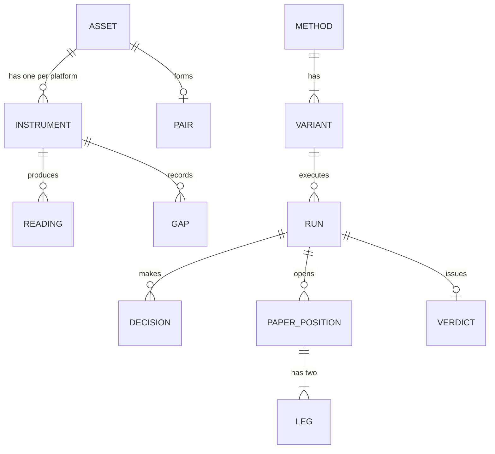
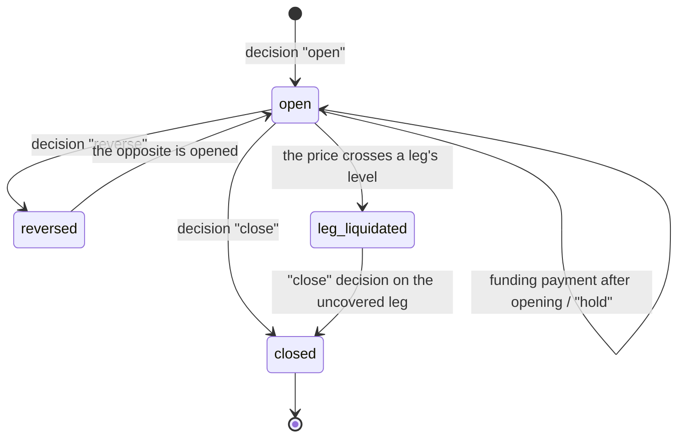

# Domain Model — Polyquack

## Ubiquitous Language

| Term | Definition | Related Requirements |
|---|---|---|
| Platform | Place where perpetuals are traded. In the MVP: Polymarket Perps and Hyperliquid. | CON-008 |
| Asset | What a perpetual tracks, for example BTC or ETHFI. It is the key for pairing. | FR-002 |
| Instrument | The perpetual of an asset on a platform, with its parameters: max leverage, maintenance margin, minimum notional and status. | FR-001, FR-003, FR-008 |
| Pair | Two instruments, one per platform, that track the same asset. | FR-002 |
| Reading | A data point stored exactly as the source reported it, with its time: a funding rate, a book snapshot, a mark price or an index price. | FR-004 to FR-007 |
| Gap | An interval in which a reading was expected and did not arrive. It is recorded with its source and, if known, its cause. | FR-010, BR-001 |
| Book snapshot | Summary of an instrument's order book at one minute: best bid, best ask and cumulative notional on each side up to 0.5% of the mid price, or up to the reach of the levels the platform delivers when they do not extend that far. The reach of a side is the relative distance to the mid price of the farthest level delivered; a volume truncated at its reach is read that way and what is missing is never completed or estimated (PD-022). | FR-006, PD-012 |
| Funding | Hourly payment between longs and shorts of an instrument. If the rate is positive, longs pay. | FR-004, BR-007 |
| Funding spread | Polymarket Perps rate minus Hyperliquid rate, for the same pair and the same hour. | FR-019, BR-008 |
| Fee schedule | Taker and maker fees of a platform, with their effective date. | FR-009 |
| Method | A concrete way of looking for an edge, with rules and parameters, tested in isolation. E1 is the first. | FR-012 |
| Variant | A version of a method with its own preregistration. Changing any part of the preregistration creates a variant. | FR-013, FR-014, BR-005 |
| Preregistration | What is fixed for a variant before its first run: rules, parameters, metric, horizon, verdict criterion, reference size per leg and reference leverage. | FR-012, CON-006 |
| Run | The execution of a variant over a data period, live or re-evaluated over stored data. | FR-015, NFR-007 |
| Decision | What a run resolves for a pair at an hour: open, hold, reverse or close. It only uses readings with an earlier or equal time. | FR-020, BR-004 |
| Paper position | Two legs of opposite sides opened with the same notional, simulated without money. | BR-006 |
| Leg | Each side of the position, on one platform. | FR-021, FR-022 |
| Reference size | Notional per leg used to simulate slippage. In E1: 1,000 USD. | PD-014 |
| Reference leverage | Used to compute collateral and distance to liquidation. In E1: 2x. | PD-015 |
| Collateral | Of a position: the sum, over both legs, of the notional divided by the reference leverage. Of a run: the maximum collateral committed at the same time during the period. | BR-003, PD-020 |
| Funding accrual | Rule that decides which funding payments belong to a leg: only those the platform charges with a time strictly after the leg's opening and less than or equal to its close or liquidation. | FR-022, BR-004 |
| Excluded pair | A pair that exceeded the gap limit of PD-013 in a run. It is left out of the verdict and reported. | FR-018, PD-021 |
| Slippage | The difference between the best price and the average price obtained by walking the book snapshot for the reference size. | FR-021 |
| Basis | Difference between the asset's prices on the two platforms, and its change since the position was opened. | FR-023 |
| Liquidation | Forced close of a leg when the price crosses its liquidation level. | FR-024, FR-025, BR-010 |
| Net profit | Funding collected, minus fees, minus slippage, plus or minus basis, minus liquidation losses. | BR-002 |
| Verdict | Result of comparing a run against its criterion when the horizon is reached: continue, discard or investigate further. | FR-017 |
| Visibility | Whether a study or a method is public or private. Private by default. Only studies and methods have it; a variant has no visibility of its own and always takes that of its method. | FR-031, FR-033, CON-003 |

## Actors / Roles

- **Author**: sole operator. Preregisters methods, reviews the dashboard, decides visibility and decides what to do with each verdict.
- **Visitor**: only reads the public view.
- **Platforms** (external): Polymarket Perps and Hyperliquid. They deliver readings; Polyquack never sends them orders (NG-002).

## Core Concepts

### Pair
- Meaning: the same asset on the two platforms.
- Identity: the asset.
- Lifecycle: `active` → `close-only` (if either platform moves the instrument to close-only) → `delisted` (if either removes it).
- Invariants: has exactly one instrument per platform. An instrument without a counterpart is not a pair and is listed separately (FR-002).

### Reading
- Meaning: a data point from a source, at an hour.
- Identity: source + instrument + kind + source time.
- Lifecycle: it is appended and never edited or deleted.
- Invariants: never filled in, interpolated or carried forward (BR-001). A reading recovered later (FR-011) closes the gap that was waiting for it; it does not delete it.

### Gap
- Meaning: a hole in what was expected to be received.
- Identity: source + instrument + kind + interval.
- Lifecycle: `open` → `closed with real data` (funding only, per FR-011) or `final`. Book snapshots cannot be recovered later: their gap is final when the minute ends. A gap always covers an expected, closed interval (the minute for book snapshots and prices, the hour for funding, the failed attempt for instruments); an ongoing hole is represented by the rows of the intervals already elapsed, so a gap never has an unknown end. Book snapshot and price gaps are born `final`; funding gaps are born `open`.
- Invariants: the dashboard and the evaluator treat it as "no data", never as zero (UX-002).

### Variant (of a method)
- Meaning: a method with its fixed preregistration.
- Identity: method + variant number.
- Lifecycle: `registered` → `running` → `with verdict`. From the first run, its preregistration does not change (FR-013).
- Invariants: the verdict criterion is fixed before running (BR-005). Each variant counts as one attempt of the method (FR-014).

### Run
- Meaning: a variant applied to a period.
- Identity: variant + period + mode (live or reevaluation).
- Lifecycle: `in progress` → `complete`, or `not qualifiable` if all its pairs ended up excluded (FR-018, PD-021).
- Invariants:
  - Each decision uses only readings with an earlier or equal time (BR-004, NFR-008).
  - Re-evaluating with the same data gives the same result (NFR-007).
  - The gap limit of PD-013 is measured per pair, only between its pairing and its delisting. A pair that exceeds it is excluded from the run, with its gaps as the reason. Its profit and its collateral do not enter the verdict (PD-021).
  - The run's collateral is the maximum committed at once by its non-excluded positions (PD-020).

### Paper position
- Meaning: two opposite legs of the same pair, with the same notional.
- Identity: run + pair + opening hour.
- Lifecycle: `open` → `closed` | `reversed` (it is closed and the opposite one is opened) | `leg liquidated` (one leg liquidated and the other uncovered) → `closed`.
- Invariants:
  - Opens with the same notional on both legs (BR-006).
  - **Funding accrual:** a leg only receives payments with a source time strictly greater than its opening and less than or equal to its close or its liquidation (FR-022). A position that opens at hour t does not receive the payment of hour t. One that closes at hour t does receive it, because it was open during that hour.
  - A leg that crosses its liquidation level is recorded as liquidated (BR-010).

## Relationships and Ownership

## State Transitions

Paper position:

## Domain Boundaries / Modules

- **Ingestion**: platforms, instruments, pairs, readings, gaps and fee schedules. It owns the data exactly as it arrived; it does not interpret methods.
- **Evaluation**: methods, variants, runs, decisions, paper positions and verdicts. It only reads what Ingestion stored; it never modifies it.
- **Publishing**: visibility, and which part of the Evaluation result is exported to the public view.

## Cross-Boundary Rules

- Evaluation reads readings only by source time and cut off at the decision hour (BR-004).
- Evaluation cannot turn a gap into a value (BR-001).
- Publishing only exports what is marked public and never parameters, positions or hourly series of private methods (FR-033). A variant's data is published only if its method is public; no other flag enables it.
- Adding a new source only adds instruments and readings to Ingestion; it does not change already registered variants (NFR-012).
